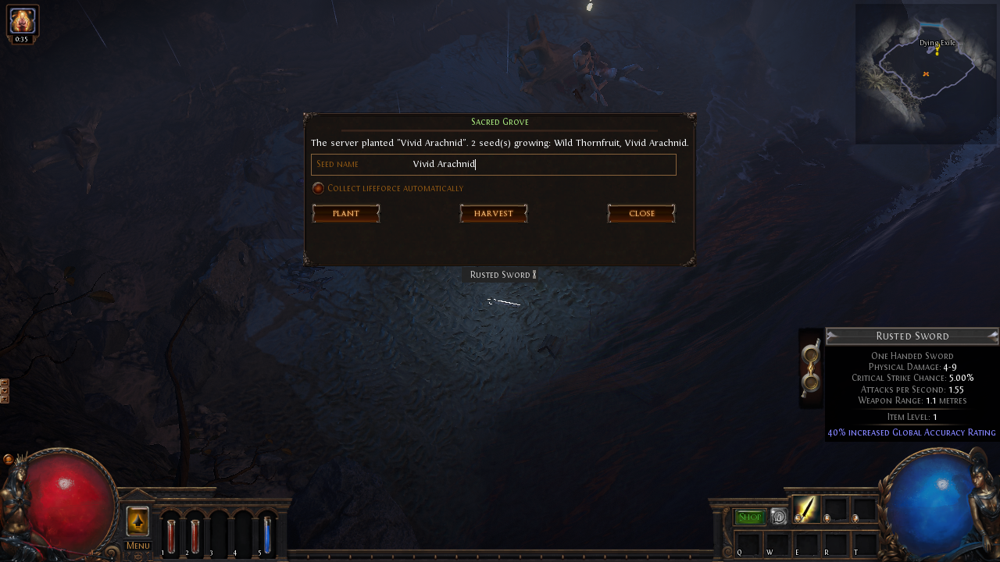

# NativeMods — Path of Exile 3.29 Client Script Extender & Dual-Side Modding Platform

**NativeMods** (`SdkVersion 1.0.0`, C ABI `0.4.0`) is the client-side script extender, managed `.NET 10` mod host, Client SDK, Gateway ServerBridge, Asset Pipeline, `nativemods` CLI, PE32+ Patcher, and Waypoint packaging stack for [LocalExile](https://github.com/LocalExile/LocalExile), targeting **Path of Exile 3.29.3d and 3.29.3c** (Win64 / Linux Proton).



*NativeMods gives LocalExile mods full access to Path of Exile 3.29's own UI system, file layer, input/hover/pre-game screens, live world entities, item filters, stats, camera, FMOD 2.03 audio, and composable multi-mod `.datpatch.json` / `.datc64` content tables — with zero edits to stock `Client/Game.exe`, `Content.ggpk`, or `Bundles2/`, zero SQLite mutation, and automatic graceful fallback for vanilla clients.*

---

## Documentation Hub

| Start Here | Best For | Link |
|---|---|---|
| **Wiki Home & Navigation Map** | Full docs sitemap, architecture overview & quickstart | [**docs/README.md**](docs/README.md) |
| **Getting Started & Mod Skeletons** | `nativemods` CLI, local `1.0.0` NuGet feed, Tier 1 vs. Tier 2 decision tree & copy-paste skeletons | [**docs/guides/getting-started.md**](docs/guides/getting-started.md) |
| **Capabilities, Limits & Hard Engine Ceilings** | **Essential for Humans & AI Agents** — What you CAN/CANNOT do, closed tables, `.ui` crash traps, ALC & HookEngine rules | [**docs/guides/capabilities-and-limits.md**](docs/guides/capabilities-and-limits.md) |
| **Autogenerated API Reference (`287` Types)** | Exact C# signatures, summaries, members & enum values across all 4 public assemblies | [**docs/api/README.md**](docs/api/README.md) |
| **Topic Guides** | [UI & Screens](docs/guides/ui-and-screens.md) · [Input, Hover & Pre-Game](docs/guides/input-hover-pregame.md) · [World, Filter, Stats & Camera](docs/guides/world-filter-stats-camera.md) · [ServerBridge](docs/guides/server-bridge.md) · [Content & Assets](docs/guides/content-and-assets.md) · [Testing & Proton](docs/guides/testing-and-proton.md) | [**docs/guides/**](docs/guides/getting-started.md) |
| **Architecture & Verification** | [Address Library](docs/architecture/address-library.md) · [Patcher & Shim](docs/architecture/patcher-and-shim.md) · [Waypoint Integration](docs/architecture/waypoint-integration.md) · [Proton Reports](docs/reports/r1-proton-results.md) | [**docs/architecture/**](docs/architecture/address-library.md) |

---

## What NativeMods Ships Today (`1.0.0`)

- **Frozen `1.0.0` SDK & Local NuGet Packaging (`src/LocalExile.Client.Sdk/`, `scripts/pack-sdk-nuget.sh`):** Versioned `LocalExile.Client.Sdk.1.0.0.nupkg` and `LocalExile.Client.ServerBridge.1.0.0.nupkg` (plus `.snupkg` symbols & XML docs), backward-compatible with `>=0.2.0`/`>=0.3.0`/`>=0.4.0`/`>=1.0.0 <2.0.0` manifests, exposing `IUiService`, `IScreensService` (9 `ScreenSlot`s), `IToastService`, `IInputService` / `IKeybindRegistry`, `IHoverService`, `IPreGameService`, `IWorldService`, `IItemFilterService`, `IStatsService`, `IGameLifecycle`, `ICameraService`, `IAudioService`, `IFileOverlayService`, `INetChannel`, Extend registries (incl. live `IContentRegistry.{RowMap, ContentRowMapDigest, TryResolveRow}`), and gated `IRawMemory`.
- **Multi-Mod `.datpatch.json` Merger & Dead-Slot Custom Stats (`src/LocalExile.Client.AssetPipeline/`, `data/schemas/`):** Schema-driven `DatPatchMerger` (`Dat64SchemaRegistry` bundled with 3.29.3d `poe-dat-schema`), Kahn topological deterministic merging across all 18 appendable tables, `$ref:TableName:EntryKey` cross-table wiring, `CloneRowDeep` zero-aliasing, auto `HASH32`/`HASH16`/unique `MtxTypes.__col18`, in-place `modify` (e.g., `StackSize = 65535`), 30-slot dead `Stats` allocator preserving stock `Stats[row].Id` + emitting UTF-16LE BOM+CRLF `Metadata/StatDescriptions/<mod>_custom_stats.txt`, and deterministic `Mods/Client/.merged-cache/content-row-map.json` SHA-256 handshake digest.
- **Scaffolding & Validation CLI (`src/LocalExile.Client.Cli/` → `nativemods`):** `nativemods new tier1|dual|content <ModId>`, `nativemods validate <modDir> [--against ...] [--json]`, and `nativemods merge --stock <dir> --out <dir> ...`.
- **Managed Client Host (`src/LocalExile.Client.Host/`):** Collectible `AssemblyLoadContext` hot reload (`UnloadedCleanly == true` via zero-pinning `CollectibleJsonCodec`), automatic `t=0` mount of `Mods/Client/.merged-cache/` (excluding `content-row-map.json` from game overlays), and `ClientHandshake.ContentRowMapDigest` advertisement.
- **Gateway ServerBridge `1.0.0` (`src/LocalExile.Client.ServerBridge/`):** `LocalExileGatewayHost` & `ClientBridgeHost` over `HostRuleset` (`0x02C9`/`0x02CA`, vanilla-safe) and `ChatFallback`, `ServerContentRowMap` + `ContentRowMapDigestMismatch` handshake verification, LocalExile Part 2b runtime catalog & drop-pool reflection helpers (`RegisterCustomBaseItem`, `RegisterCustomUnique`, `RegisterDropPoolEntry`), server-driven UI (`IClientUiSession`), Tier 1 server-only parity (`IClientPhase1Session` & `IClientPhase2Session`), atomic Gateway transactions & affix manipulation, and Pet MTX / Custom Currency registrars.
- **C++20 Win64 Script Extender (`src/native-shim/`):** `LocalExile.ClientHost.dll` + optional `version.dll` proxy (`NM_ABI_VERSION 0x00000400`, `864 B` / `107` ABI slots / `122` exports), Route A universal file overlays armed before CoreCLR boot, off-thread `.NET 10` CoreCLR bootstrap (`~250 ms`), `HookEngine` x64 relocation & Pre/Post chaining with Win64/DWARF unwind tables, FMOD 2.03 looping `.ogg` playback, and `0xE06D7363` SEH/C++ exception walls.
- **Asset Pipeline, PE32+ Patcher & Waypoint (`src/LocalExile.Client.{AssetPipeline,Patcher,Waypoint}/`):** `.glb` → `.smd`/`.sm`/`.mat`/`.ast` v7, DX10 `.dds` + `.dds.header`, `.opus` → 48 kHz stereo Vorbis `.ogg`, reversible `.nmimp` PE32+ patching (`NMUNPAT1`), `UiLayoutLinter`, `DualModPackageValidator` (`DAT001..DAT009`, `CNF007..CNF009`), automatic `WaypointModInstaller` `.merged-cache/` rebuild & `DeploymentLedger.MergedCacheDigest`, and `NMB1` stored-block bundling.
- **Address Library (`data/addresses/`):** `319` verified `3.29.3d` symbols, `300` offsets, and `18` constants (`scripts/generate-address-table.py --check`).

---

## Reference Showcases (`examples/`)

| Showcase Mod | Capabilities Demonstrated |
|---|---|
| `examples/DualMod.ContentPackDemo/` | **Phase 3 (`1.0.0`):** Two independent `.datpatch.json` mods (`ModAlpha.AetherRelics` + `ModBeta.StackMastery`) sharing `BaseItemTypes`, `ItemVisualIdentity`, `CurrencyItems`, `Mods`, and dead `Stats` slots cleanly into `.merged-cache/` + `content-row-map.json` (incl. `StackSize = 65535` & Route A `StatDescriptions`) |
| `examples/DualMod.SiphonOrb/` | **Updated `1.0.0`:** Brand-new dual-stage Custom Currency with declarative `client/patches/siphon-orb.datpatch.json`, configurable `settings.json` natural world drops via LocalExile Part 2b `ItemCatalog.RegisterOverlay` + `DropDataProvider.Default.RegisterOverlay` (zero SQLite mutation, zero reflection), `78×78` flood-fill RGBA8 icons, `SiphonPicker.ui`, and affix steal/store/imbue |
| `examples/DualMod.LootTools/` | **Phase 2 (`0.4.0`):** Filter-Aware Loot Magnet (`Alt+M`), AoE Pickup (`Alt+G`), Atomic Ground Loot Merger (`Alt+R` + `AreaTick`), Item Filter Reload (`Alt+F`), `LootToolsPanel.ui`, ALC-safe Camera Zoom Override — **zero LocalExile server edits** |
| `examples/DualMod.StashQol/` | **Phase 1 (`0.3.0`):** Deposit All, Vendor All, Inventory Sort, Map/Blight Upgrades, Regex Roller, `Ctrl+Shift+RMB` Bulk Stack Use, PoB Passive Import + HUD Toasts |
| `examples/DualMod.SkipCampaign/` | **Phase 1 (`0.3.0`):** `Skip Campaign` checkbox on `LeagueOverlay` & `CreateCharacterBar`, `C→S 0x12` option injection via `IPreGameService`, `GameEvents.CharacterCreated` |
| `examples/DualMod.MaxwellPet/` | Brand-new Pet MTX (`MtxTypes`/`MtxTypeGameSpecific`/`Pet` `.datc64`, Cosmetics `K` menu equip, `.glb` 3D model, `MaxwellPanel.ui`, looping FMOD 2.03 `.ogg` audio) |
| `examples/DualMod.HarvestGarden/` | Custom UI control (`GrowthGauge`), custom GEAL built-in (`GardenRipen`), custom ruleset (`0xA1`), custom opcode, hot reload, and vanilla chat fallback |

---

## Quickstart & Verification

```bash
# 1. Verify Address Library and Autogenerated API Docs have zero drift
python3 scripts/generate-address-table.py --check
python3 scripts/generate-api-docs.py --check

# 2. Build & run all .NET 10 test suites (40 projects, 12 test suites, 381/381 passing, 0 warnings)
dotnet build NativeMods.slnx -c Release
dotnet test NativeMods.slnx -c Release --no-build

# 3. Pack versioned 1.0.0 local NuGet packages (Sdk & ServerBridge + .snupkg)
./scripts/pack-sdk-nuget.sh -o dist/nuget

# 4. Scaffold, validate, or merge multi-mod .datpatch.json packs with nativemods CLI
dotnet run --project src/LocalExile.Client.Cli -- new dual my-feature --out ./my-feature
dotnet run --project src/LocalExile.Client.Cli -- validate examples/DualMod.ContentPackDemo/ModAlpha.AetherRelics \
  --against examples/DualMod.ContentPackDemo/ModBeta.StackMastery

# 5. Build & run C++20 native shim tests (28/28 passing, -Wall -Wextra -Wpedantic -Werror)
cmake -S src/native-shim -B build/native-shim -DCMAKE_BUILD_TYPE=Release
cmake --build build/native-shim
ctest --test-dir build/native-shim --output-on-failure
```

Verified live on isolated `Xvfb` **Path of Exile `3.29.3d`** under Proton (`SDK 1.0.0`, `abi=0x00000400`, `319` symbols / `300` offsets): **`25/25`** live hooks `OK`, **`16/16`** E2E checks passing (`E2E-01 PASS sdk=1.0.0`), **`2,400+`** frames, **`0`** warnings/errors/SEH faults, FMOD PCM `-24.5 dB / -10.0 dB`, and exact stock `Game.exe` / `Game.patched.exe` SHA-256 restored.

---

## Ground Rules & License

- **Frozen target builds:** Path of Exile **3.29.3c** and **3.29.3d** only, exclusively for offline/private [LocalExile](https://github.com/LocalExile/LocalExile) servers — never for official GGG servers.
- **Zero copyrighted assets in git:** No stock game files, `.datc64`, `.dds`, or media are committed; local asset overlays are generated into gitignored `dist/`.
- **Historical pre-implementation design notes:** Archived under [`docs/archive/initial-design/`](docs/archive/initial-design/README.md).
- **License:** GPL-2.0 (`LICENSE`), matching LocalExile. Path of Exile is a trademark of Grinding Gear Games; this project is not affiliated with or endorsed by them.
