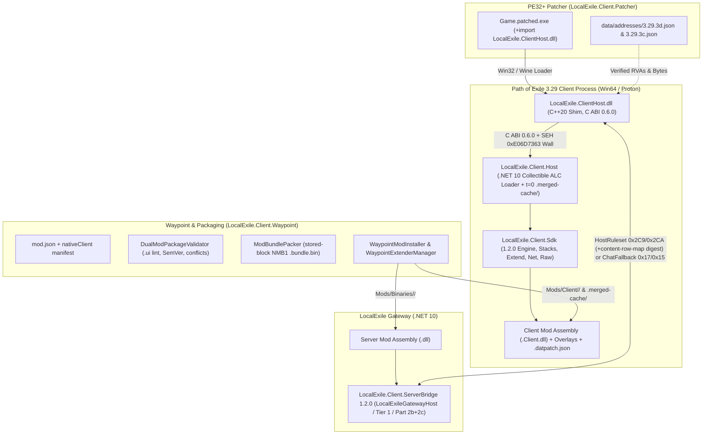

# NativeMods Documentation Wiki

Developer and mod-authoring documentation for **NativeMods** (`SdkVersion 1.2.0`, C ABI `0.6.0`, `447` verified `3.29.3d` symbols / `373` offsets) — the universal client script extender, managed `.NET 10` mod host, public Client SDK, LocalExile ServerBridge, Asset Pipeline (`DatPatchMerger` + `.fmt`/`.ast`/`.smd` 3D pipeline), `nativemods` CLI, PE32+ Patcher, and native opt-in Waypoint integration targeting **Path of Exile 3.29.3d and 3.29.3c**.

---

## Start Here: Human Modder vs. AI Coding Agent

| If You Are... | Read These Pages First (In Order) |
|---|---|
| **An AI Coding Agent** implementing or reviewing a mod | 1. [**Capabilities, Limits & Hard Engine Ceilings**](guides/capabilities-and-limits.md) *(mandatory pre-flight invariants & crash traps)* 2. [**Autogenerated API Reference**](api/README.md) *(exact signatures for all 342 public types across 4 assemblies)* 3. [**Getting Started & Skeletons**](guides/getting-started.md) *(`nativemods` CLI, `1.2.0` NuGet feed, Tier 1 vs. Tier 2 `.csproj` & `mod.json` rules)* 4. Topic guide for your feature area below |
| **A Human Mod Author** building your first mod | 1. [**Getting Started & Decision Tree**](guides/getting-started.md) 2. [**Harvest Garden Walkthrough**](guides/harvest-garden-walkthrough.md) 3. [**Capabilities & Limits**](guides/capabilities-and-limits.md) 4. [**Testing & Live Proton Guide**](guides/testing-and-proton.md) |
| **An Extender / Core Contributor** working on C ABI, hooks, or Waypoint | 1. [**Address Library**](architecture/address-library.md) 2. [**Patcher & Native Shim**](architecture/patcher-and-shim.md) 3. [**Waypoint Integration**](architecture/waypoint-integration.md) 4. [Proton Reports](reports/r1-proton-results.md) & [Maxwell PoC Report](reports/maxwell-pet-poc.md) |

---

## Navigation Map

### Modding Guides (`docs/guides/`)

| Guide | Covers |
|---|---|
| [**Getting Started**](guides/getting-started.md) | `nativemods new`/`validate`/`merge` CLI, `./scripts/pack-sdk-nuget.sh` local `1.2.0` NuGet feed, Tier 1 single-`.cs` Roslyn vs. Tier 2 dual-side DLL decision tree, reference showcases (`DualMod.IdolsAndGearVault`, `DualMod.ContentPackDemo`, `DualMod.SiphonOrb`, `DualMod.LootTools`, etc.), `.csproj` & `mod.json` skeletons |
| [**Capabilities & Limits**](guides/capabilities-and-limits.md) | Structured What You CAN / CANNOT Do matrix, **22 appendable** vs. closed `ItemClasses` & `Stats` (30 dead slots + high-ID `>= 0x10000`), 12+3+1 text encodings, opt-in `u32` stacks, `ModHost` reload hazard, threading/TID migration, ALC/STJ pinning, `HookEngine` `<=8` vs `>8` args, `Control::ReleaseOrDestroy`, `.ui` crash traps, `GealBuiltinEntry` `alignas(16)` / 7-slot MSVC `_Func_base` / ruleset `0xA0` occupied rules, `WorldItem` zero-ghost-label rule, troubleshooting cheat sheet |
| [**UI & Stock Screens**](guides/ui-and-screens.md) | `.ui` layouts, `UiLayoutLinter`, `IUiService`, typed & programmatic rich controls (`ILabel`, `IButton`, `ITextBox`, `ICheckBox`, `IPicture`, `IScrollableFrame`, `ITabContainer`, `IComboBox`, `IListBox`), `IUiItemGrid`, compact 6-socket rendering (`SetCompactSocketsEnabled`), `ITooltipService`, `IStashAffinityService`, `IClipboardService`, stock-tree traversal, live native `ICustomUiControl`, `IScreensService` & 9 `ScreenSlot`s, `IToastService` |
| [**Input, Hover & Pre-Game**](guides/input-hover-pregame.md) | `IInputService`, `IKeybindRegistry` (`Mods/Client/keybinds.json`), `Ctrl+Shift+RMB` suppression, `IsTextInputFocused`, `IHoverService`, `IPreGameService` (`LeagueOverlay` & `C→S 0x12` `S78` injection) |
| [**World, Filter, Stats & Camera**](guides/world-filter-stats-camera.md) | `IWorldService` (`EntityManager` + 14 components + `CreateClientObjectEx` + `PlayEffect`), `IItemFilterService`, `IStatsService` (incl. `>= 0x10000`), `IGameLifecycle` area events, `ICameraService` (`TryWorldToScreen`, `TryWorldToUiPosition` + ALC-safe zoom), `DualMod.LootTools` blueprint |
| [**ServerBridge & Extender Registries**](guides/server-bridge.md) | `ServerBridge 1.2.0`, `HostRuleset` vs. `ChatFallback`, `LocalExileGatewayHost` (`global::Client.For`), `ServerContentRowMap` handshake digest check, LocalExile Part 2b & 2c catalog/drop-pool/league overlays, `IClientUiSession`, Tier 1 `IClientPhase1Session`, `IClientPhase2Session`, & **`IClientPhase4Session`**, `LocalExileGatewayTransactions`, `LocalExileItemAffixService`, `IStackExtensionService`, live native GEAL / Rulesets (`0xAE`) / Opcodes / `IRawMemory` |
| [**Content, Assets & Packaging**](guides/content-and-assets.md) | Route A file overlays & `t=0` `.merged-cache/` auto-mount, schema-driven `.datpatch.json` + `DatPatchMerger` (**22 appendable tables**) + 30 dead `Stats` slots + `content-row-map.json`, `DualMod.ContentPackDemo`, `DualMod.SiphonOrb` natural currency drops, `.glb` → `.fmt` static meshes / multi-bone `.ast` / 4-bone skinned `.smd` (`convert-glb-fmt`/`convert-glb-smd`/`inspect-mesh`), `.dds` + `.dds.header`, FMOD 2.03 2D/3D spatial `.ogg` audio, Pet MTX Cosmetics `K` menu, `DualModPackageValidator`, `NMB1` bundles |
| [**Testing & Live Proton**](guides/testing-and-proton.md) | `SimulatedNativeBridge`, collectible ALC unload verification, live Roslyn Gateway compile tests, C++20 shim tests, `./scripts/build-win64.sh`, isolated `Xvfb` `3.29.3d` Proton runners & expected log markers |
| [**Harvest Garden Walkthrough**](guides/harvest-garden-walkthrough.md) | End-to-end step-by-step walkthrough of `examples/DualMod.HarvestGarden/` |

### Autogenerated API Reference (`docs/api/`)

Deterministically generated directly from C# declarations & `///` XML docs (`python3 scripts/generate-api-docs.py --check`):

- [**API Reference Index (A–Z, 342 Public Types)**](api/README.md)
- [Client SDK — Core & Address Library](api/sdk-core.md)
- [Client SDK — UI, Stock Screens & Toasts](api/sdk-ui-screens.md)
- [Client SDK — Input, Keybinds, Hover & Pre-Game](api/sdk-input-hover-pregame.md)
- [Client SDK — World, Audio, Stats, Lifecycle, Item Filter & Camera](api/sdk-world-filter-stats-camera.md)
- [Client SDK — Networking, Overlays, Protocol, Extend & Raw](api/sdk-net-files-raw-extend.md)
- [ServerBridge API Reference](api/server-bridge.md)
- [AssetPipeline API Reference](api/asset-pipeline.md)
- [Waypoint Integration API Reference](api/waypoint.md)

### Architecture, Reports & Archive

- **Architecture:** [Address Library](architecture/address-library.md) · [Patcher & Native Shim](architecture/patcher-and-shim.md) · [Waypoint Integration](architecture/waypoint-integration.md)
- **Empirical Verification Reports:** [Spike R1 Proton Results](reports/r1-proton-results.md) · [Maxwell Pet MTX PoC Results](reports/maxwell-pet-poc.md)
- **Historical Archive:** [Initial Pre-Implementation Design Docs (`01`–`12`)](archive/initial-design/README.md)

---

## Architecture Overview

---

## Verified `1.2.0` Baseline

- **`.NET 10` Solution (`NativeMods.slnx`):** `44` projects (`7` libraries/tools incl. `nativemods` CLI, `21` example projects across `8` showcases incl. `DualMod.IdolsAndGearVault`, `16` test projects / `13` xUnit test suites), **`434/434` tests passing**, `0` warnings (`TreatWarningsAsErrors=true`).
- **Autogenerated API Docs (`docs/api/`):** **`342`** public types, **`2,817`** public members/parameters, `13` namespaces across `9` pages (`python3 scripts/generate-api-docs.py --check`).
- **C++20 Native Shim (`src/native-shim/`):** **`35/35` tests passing** under `-Wall -Wextra -Wpedantic -Werror` (C ABI `0.6.0`, `1168 B` / `145` slots / `162` exports; `447/447` `port-address-library.py --verify-self` exact RVA & byte parity).
- **LocalExile Part 2b + 2c (`c0392f414` atop `origin/main` `affb3b104`):** `43/43` `GameServer.Data.Tests`, `552/553` `GameServer.Core.Tests` (1 skip), `1,608/1,608` `GameServer.Gateway.Tests`, plus `76/76` NativeMods live Roslyn compile checks (`0` warnings/errors).
- **Waypoint Opt-In Integration (`feat/nativemods-integration`, `1a346cb`):** WPF (`src/Waypoint`) + Avalonia (`src/Waypoint.Linux`) parity, EN/RU/ZH-CN localization, `ProxyVersionDll` default on release/Proton + `ImportTable` on source checkouts, `NativeModsChecks` (24 checks) & `Waypoint.Tests/NativeModsTests`.
- **Live Isolated `Xvfb` `3.29.3d` Proton:** Verified `1.1.0` baseline (`33/33` hooks `OK`, `16/16` E2E PASS, FMOD PCM `-24.5 dB / -9.6 dB`); `1.2.0` (`abi=0x00000600`) verified **`38/38`** live hooks `OK` (incl. `[PHASE5]` 5/5) with exact SHA-256 baseline restored.
