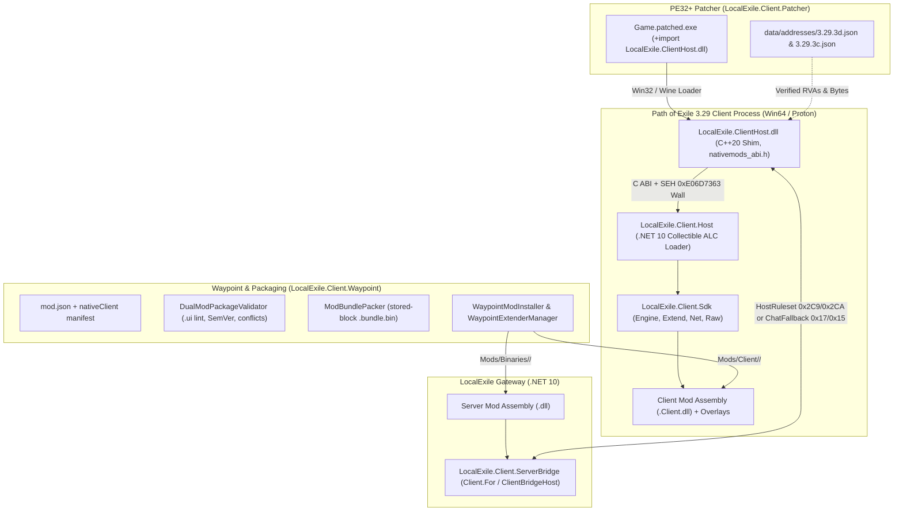

# NativeMods Documentation

Developer documentation for the **NativeMods 3.29** Proof of Concept — a universal client script extender, managed `.NET 10` mod host, public Client SDK, LocalExile Server Bridge, PE32+ patcher, and Waypoint dual-side mod integration targeting **Path of Exile 3.29.3c and 3.29.3d**.

> **Status:** Proof of Concept (`SdkVersion 0.1.0-poc`, C ABI `0.1.0`). All reverse-engineered addresses, offsets, and constraints are grounded in [`07-spike-results.md`](../07-spike-results.md), [`08-deep-analysis.md`](../08-deep-analysis.md), [`10-verification.md`](../10-verification.md) (authoritative where `08`/`09` disagree), [`11-client-sdk.md`](../11-client-sdk.md), and [`12-ceiling.md`](../12-ceiling.md).

## Documentation Index

| Guide | Audience | Covers |
|---|---|---|
| **[Modding Reference](modding-reference.md)** | **Human mod authors & AI coding agents** | **Start here!** Copy-paste mod skeletons (Server-only, Client-only, Dual-Side), non-negotiable 3.29 invariants, complete API cookbook (`.ui`, overlays, looping `.ogg` audio, networking, GEAL/rulesets/opcodes, brand-new `.datc64` content & Pet MTX Cosmetics `K` menu registration, `AssetPipeline`, `Raw`), testing & live Proton workflow |
| [API Reference](api-reference.md) | Mod authors, framework contributors | `LocalExile.Client.Sdk` (`IClientMod`, `IClientContext`, `IAddressLibrary`, `Engine`, `Extend`, `Net`, `Raw`), `LocalExile.Client.ServerBridge`, threading & exception-wall contracts, versioning |
| [Address Library](address-library.md) | Reverse engineers, extender maintainers | `3.29.3d` / `3.29.3c` JSON schema (`schemaVersion: 1`), verified symbol & offset tables, expected-byte checks, workflow for adding new symbols |
| [Patcher & Native Shim](patcher-and-shim.md) | Extender & launcher developers | `LocalExile.Client.Patcher` CLI & library, PE32+ import patching vs. `version.dll` proxy, `nativemods_abi.h` C ABI, deferred CoreCLR boot, `DeadlockDetector` & Wine/Proton mitigations |
| [Waypoint Integration](waypoint-integration.md) | Launcher & mod packagers | `mod.json` `nativeClient` manifest schema, `LocalExile.Client.Waypoint` API, security & trust model, `.ui` linting, stored-block bundles, install layout |
| [Authoring Dual-Side Mods](authoring-dual-mods.md) | Mod authors | End-to-end walkthrough of `examples/DualMod.HarvestGarden/` (Server + Client + Shared + `.ui` + `.ot` GEAL script + custom opcode + hot reload + graceful degradation) |
| [Spike R1 Proton Results](r1-proton-results.md) | Contributors, testers | Empirical `.NET 10` CoreCLR + `StateStack::PassA` live 3.29.3d Proton results (`proxy` & `import-patch` modes, VEH `0xE06D7363` coexistence, TID migration finding) |
| [Maxwell Pet MTX PoC Results](maxwell-pet-poc.md) | Contributors, testers | Empirical live 3.29.3d Proton results for `DualMod.MaxwellPet` (16/16 pass: Cosmetics `K` menu Pet Slot 1 equip, Route A `.datc64` + 18 3D assets, centered interactive `MaxwellPanel.ui`, looping FMOD 2.03 OGG audio `-23.1 dB`) |

## Architecture Overview



## Repository Structure

| Path | Description |
|---|---|
| `NativeMods.slnx` | Root `.NET 10` solution covering SDK, Host, ServerBridge, Patcher, Waypoint, Examples, and Tests |
| `data/addresses/` | Verified 3.29.3d / 3.29.3c Address Library JSON databases and JSON schema |
| `src/native-shim/` | C++20 Win64 script extender shim (`LocalExile.ClientHost.dll`), `include/nativemods_abi.h`, CMake build, and host-side tests |
| `src/LocalExile.Client.Patcher/` | Cross-platform PE32+ patcher library and CLI (`check`, `patch`, `unpatch`, `verify`, `dump-addresses`) |
| `src/LocalExile.Client.Sdk/` | Public versioned C# SDK that third-party client mods compile against |
| `src/LocalExile.Client.Host/` | Managed `.NET 10` client runtime, collectible `AssemblyLoadContext` hot-reload loader, `NativeShimBridge`, and `SimulatedNativeBridge` |
| `src/LocalExile.Client.ServerBridge/` | LocalExile Gateway-side bridge for handshake negotiation, typed messaging, server-driven UI, and reusable Pet MTX Cosmetics `K` menu registration (`PoeContentHash`, `CustomPetMtxDefinition`, `LocalExilePetMtxRegistrar`) |
| `src/LocalExile.Client.AssetPipeline/` | 3.29.3d asset & `.datc64` pipeline library + CLI (`.glb` → `.smd`/`.ast` v7, DX10 `.dds` + `.dds.header`, `Dat64TablePatcher` / `MaxwellDatPatcher`, `Bundles2Reader`, `AudioTranscoder`) |
| `src/LocalExile.Client.Waypoint/` | Waypoint manifest parser, `.ui`/conflict validator, stored-block bundle packer, and installer |
| `examples/DualMod.HarvestGarden/` | End-to-end dual-side Harvest Garden PoC mod |
| `examples/DualMod.MaxwellPet/` | End-to-end brand-new Pet MTX dual-side mod (`Maxwell the Cat`, Cosmetics `K` menu, `.ui` panel, looping `.ogg` audio) |
| `scripts/` | Cross-compilation (`build-win64.sh`), Maxwell asset generator (`build-maxwell-assets.sh`), and isolated `Xvfb` Proton test runners (`run-r1-proton.sh`, `run-maxwell-proton.sh`) |
| `tests/` | Automated xUnit test suites for Patcher, SDK/Host/ServerBridge, AssetPipeline, MaxwellPet, and Waypoint/HarvestGarden E2E |
| `.codexmind/` | Cross-session research findings, architecture decisions, and known regressions |

## Quickstart

### Prerequisites

- **.NET 10 SDK** (`net10.0`, tested with `10.0.403`)
- **C++20 compiler & CMake** (`clang++` or `g++`, `cmake`) for native shim host-side unit tests
- *(Optional, for building the Win64 `LocalExile.ClientHost.dll` binary)* MSVC (`cl.exe`) on Windows or a MinGW-w64 cross-toolchain

### 1. Build and Run All .NET Tests

```bash
dotnet build NativeMods.slnx -c Release
dotnet test NativeMods.slnx -c Release --no-build
```

Verified baseline: **105/105 .NET xUnit tests passing** (`NativeMods.slnx`: 82 — `LocalExile.Client.Tests`: 41, `LocalExile.Client.Waypoint.Tests`: 32, `LocalExile.Client.Patcher.Tests`: 9; plus `LocalExile.Client.AssetPipeline.Tests`: 10 and `LocalExile.Client.MaxwellPet.Tests`: 13) with 0 warnings and 0 errors (`TreatWarningsAsErrors=true`).

### 2. Build and Run Native Shim Host-Side Tests (Linux / Cross-Platform)

```bash
cmake -S src/native-shim -B build/native-shim -DCMAKE_BUILD_TYPE=Release
cmake --build build/native-shim
ctest --test-dir build/native-shim --output-on-failure
```

Verified baseline: **10/10 C++20 shim tests passing** under `-Wall -Wextra -Wpedantic -Werror`.

### 3. Inspect Addresses and Run the Patcher CLI

```bash
# Dump verified 3.29.3d symbols from the Address Library
dotnet run --project src/LocalExile.Client.Patcher -- dump-addresses --addresses data/addresses

# Inspect a 3.29 client executable (or a test binary with --allow-synthetic)
dotnet run --project src/LocalExile.Client.Patcher -- check /path/to/Game.patched.exe --addresses data/addresses

# Patch and verify (reversible with `unpatch`)
dotnet run --project src/LocalExile.Client.Patcher -- patch /path/to/Game.patched.exe --addresses data/addresses
dotnet run --project src/LocalExile.Client.Patcher -- verify /path/to/Game.patched.exe --addresses data/addresses
dotnet run --project src/LocalExile.Client.Patcher -- unpatch /path/to/Game.patched.exe
```

### 4. Run the Harvest Garden Dual-Side E2E Simulation

The `tests/LocalExile.Client.Waypoint.Tests` suite wires `examples/DualMod.HarvestGarden/` end-to-end across `ClientHostRuntime` (`SimulatedNativeBridge`) and `ClientBridgeHost`, exercising `.ui` loading, custom GEAL built-in registration (`GardenRipen`), custom UI controls (`GrowthGauge`), typed messaging, and graceful chat fallback without requiring a game binary:

```bash
dotnet test tests/LocalExile.Client.Waypoint.Tests
```
