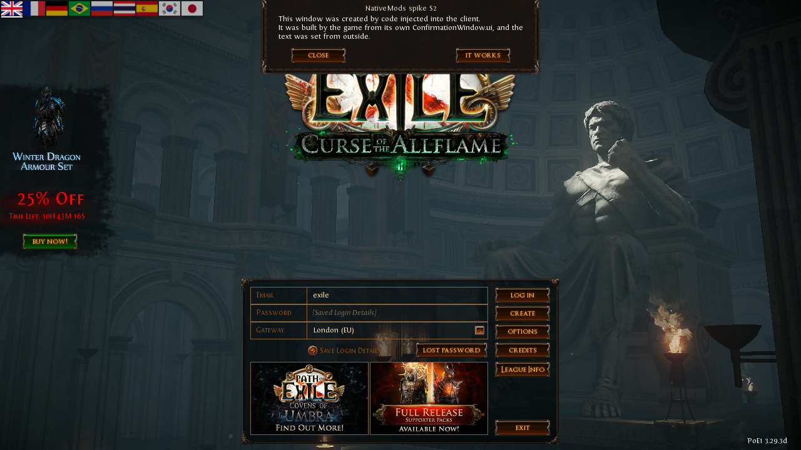
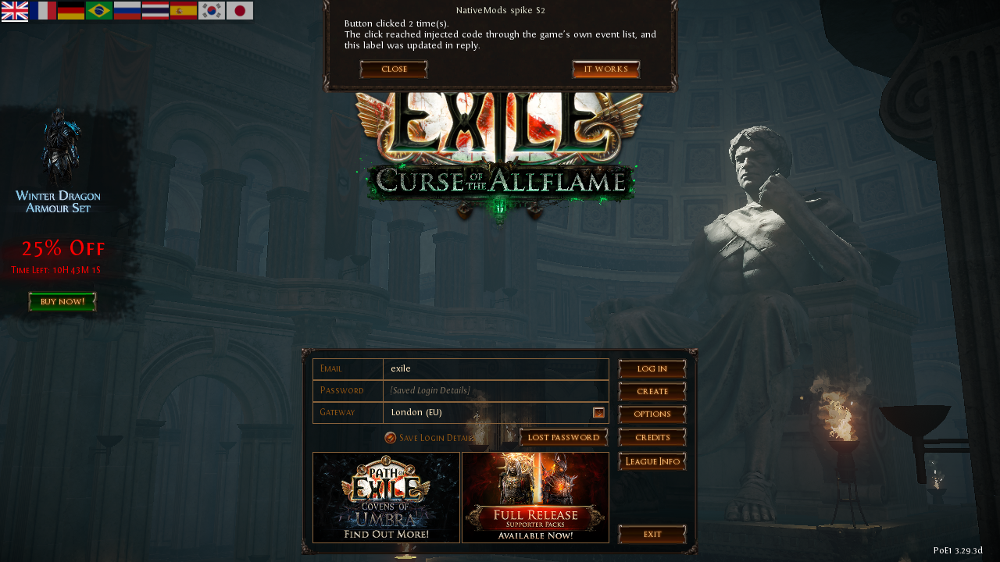
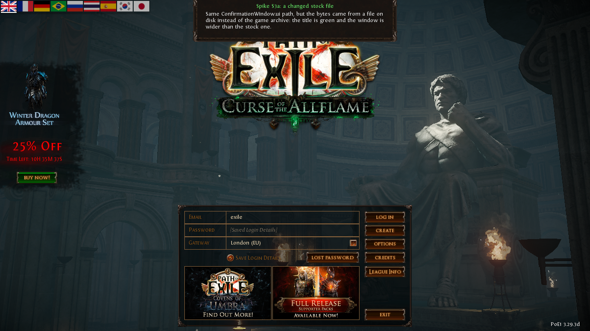
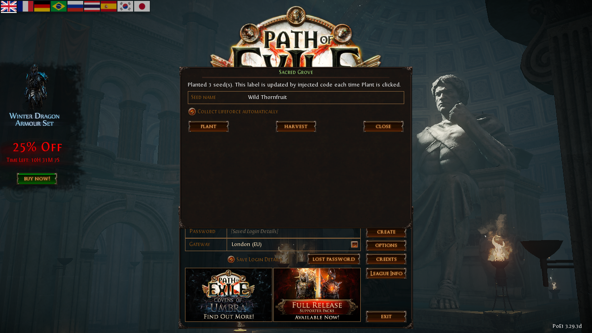
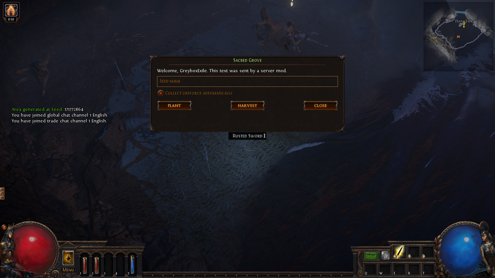
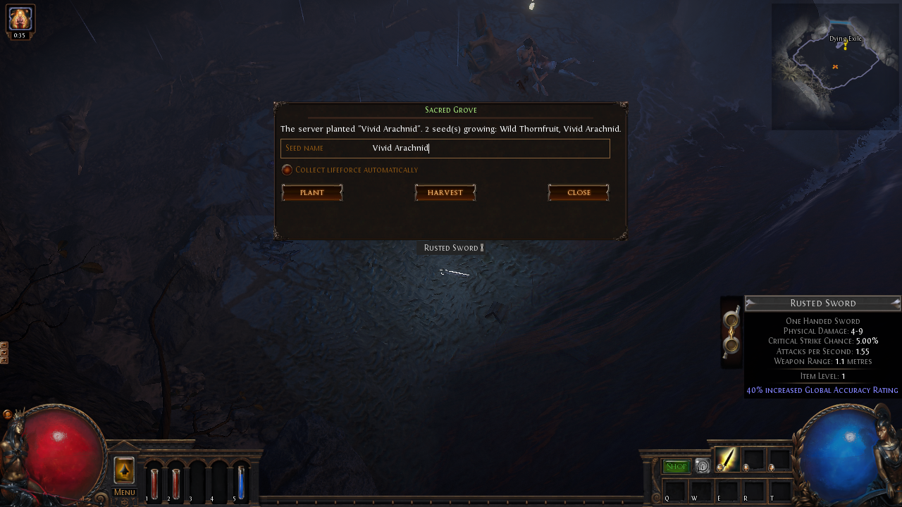
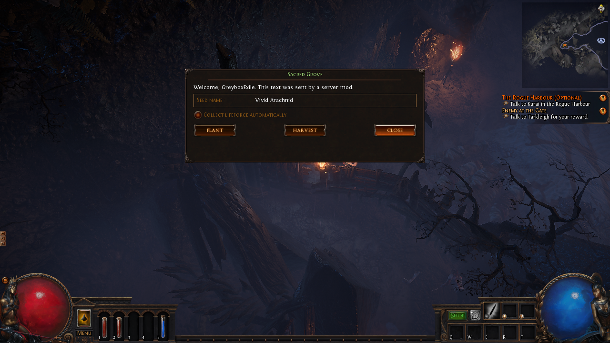
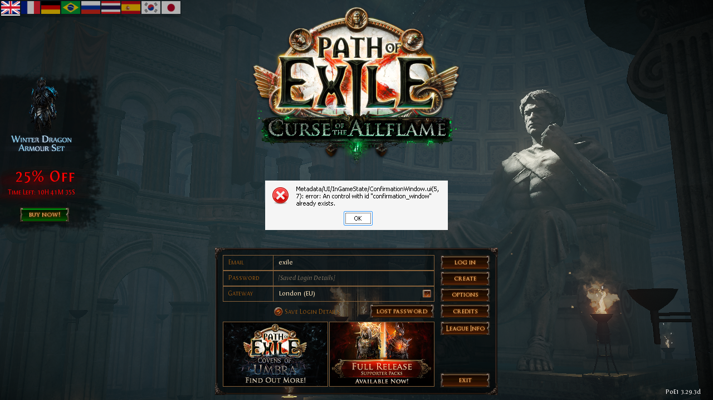

# Spike results

Run on 2026-11-18 against the **3.29.3d** client (build 328228) under Proton on Linux, with a LocalExile stack from
`main` (`b061880c6`). Nothing was run on 3.29.3c or on Windows. The test code is in [spikes/](../../../spikes/).

## Summary

| Spike | Question | Result |
|---|---|---|
| S2 | Can outside code create a native window from a `.ui` file? | **Pass** |
| S5 | Can it react to a click and change a control? | **Pass** |
| S3a | Can a stock file be served from disk instead of the archive? | **Pass** (text files) |
| S3b | Can a file the game never had be served? | **Pass** (text files) |
| S4 | Can a server mod and the client exchange messages? | **Pass**, over chat lines; a dedicated message id is not tested |
| S0 | Does the client object to any of this? | Nothing seen, in a short session |
| S1 | Loading the host through the import table | **Not run** |
| S3c | Reloading a changed file without a restart | **Not run** |
| S6, S7, S8 | New image, new table row, ruleset messages | **Not run** |

The go/no-go question, native UI, is answered: **go**.

## How it was run

The plan was to prototype with Frida before writing any C++. On this host that means Frida Gum loaded into the
Wine process with `LD_PRELOAD` (`spikes/spikehost.cpp`, derived from LocalExile's walk-map recorder), running
`spikes/agent.js`. The client was started only through `live.ps1`, with `Game_CLIENT_RUNNER` pointing at a wrapper
that sets the preload. Commands were dropped into an inbox file and run on the game's main thread.

This is a test rig, not the proposed loader. It proves what the client's own functions do when called from outside;
it says nothing about loading a Windows DLL through the import table (S1).

## S2: a native window

Calling four client functions from outside builds a working window:

```
pool   = 0x1418b6d20()                       control allocator
frame  = 0x14014b0e0(pool)                   a new Frame
         0x1418b5b10(parent + 0xb8, n, frame)   add as the parent's n-th child
         0x1418b08d0(control, &path)         load a .ui file into a control
child  = 0x1418b6420(control + 0xb8, &"a.b.c")  find a child by id path
```

The first try loaded the stock `ConfirmationWindow.ui` into the root control of the login screen, found its labels
and buttons by id, set their text and made the buttons visible:



It is the game's own window: its border art, fonts, layout and scaling, drawn by the game.

## S5: events

A control's events are lists of small handler records, looked up by the event's address
(`0x14019b2b0(button + 0x2a0, &out, create)`). Appending a record `{vtable, context}` whose vtable points at our own
functions makes the game call us when the button is clicked. Two clicks on "It works":



## S3: files from disk

Text files (`.ui`, and the same stream also opened `.mat` files during the test) are read through one function,
`0x1421d5b50(streambuf, &path, keepBom, &path)`, which reads the whole file into a buffer. Replacing that buffer
after the call serves any content for any path, whether the game has the path or not.

**S3a**, the stock `ConfirmationWindow.ui` path with two values edited on disk. The title colour changed. The size
edit made no visible difference, because the window sizes itself to its content, so the sentence in the window
about it being wider is wrong:



**S3b**, `Metadata/UI/Mods/Spike/Garden.ui`, a path that does not exist in the game, written by hand
([the file](../../../spikes/overlay-src/metadata/ui/mods/spike/garden.ui)): a framed window with a title, a divider image, a
label, a text box, a check box and three buttons. Typing, ticking and clicking all work:



Binary files (images, tables, models) go through a different read path and were not tested.

## S4: a server mod drives the window

To avoid any Gateway change, the first transport is the chat the game already has:

- **Server to client:** an ordinary chat line (S→C `0x17`) whose text starts with `##NM `. The client's chat
  listener `0x14017a270` is replaced; such lines are handled and never shown.
- **Client to server:** an ordinary chat command (C→S `0x15`), written with the client's own socket writer under
  the socket lock, as LocalExile's `client-control.js` already does.

The server half is a 40-line script mod, [spikes/server-mod/nmspike.cs](../../../spikes/server-mod/nmspike.cs), dropped into
`Mods/Binaries/` while the Gateway ran (it hot-loaded). Typing `/garden` in the game's chat:



Typing a seed name and clicking Plant sends `/nm plant <name>`; the mod keeps the list and answers:



The Gateway's log shows the two messages arriving as normal chat
(`<= 0x0015 chat "/nm plant Wild Thornfruit"`).

After `/goto 1_1_town` (a new area, so a new connection on the server) the window was still attached to the same
in-game root, kept its state, and `/garden` reached the new connection's mod instance:



Chat is good enough for a first version and for anything a player triggers. It is not a final channel: it is text
only, it is as slow as chat, and it shares the chat command namespace. The dedicated message id in
[architecture](02-architecture.md) §4 remains the target.

## What went wrong, and what it taught

**1. A parse error closes the client.** Loading a layout whose top-level id already exists under the same parent
made the parser throw, and with nobody catching it the client showed this and exited:



- The parser reports file, line and column. Other messages seen: `error: ":" expected` for an unknown property
  name, and `Syntax error. You must have a space before <DEFINITIONS>` for a file that starts with that line.
- **The host must catch C++ exceptions around every loader call**, and a linter must run before a file ever reaches
  the game ([tooling](05-tooling-and-assets.md)).
- Ids must be unique among siblings, so the host needs one container per mod window, and a way to remove a window
  before loading it again. Removing a control was not worked out.

**2. One layout made the game spin forever, with no error.** A `Picture` with a `margin` inside a `StackLayout`
froze the main thread at 100% CPU. A spacer `Frame` does the job instead (the stock files do the same). The linter
needs a list of such combinations; there will be more.

**3. Frida does not fire its hooks for calls made from inside another hook.** Loads started from the frame hook
bypassed the file overlay. The rig now runs commands from a thread timer on the main thread instead. This is a
property of the test tool, not of the game, and does not apply to a native host.

**4. A fatal error is shown by a second process** while the first one exits, so anything not written to disk at
once is lost. The rig writes a synchronous trace file for that reason.

**5. LocalExile's `scripts/walkmaps/proton.py prepare` failed** on this host: the Frida devkit archive lists its
members as `./frida-gumjs.h`, and the script asks for `frida-gumjs.h`. The archive was extracted by hand after
checking its SHA-256 against the one in the script. Worth a small fix upstream.

## What was learned about the UI system

| Thing | Where |
|---|---|
| Control id | `std::wstring` at `+0x1b8` |
| Parent | `+0x1e0` |
| Children | container at `+0xb8`; pointer array from `+0xc0` to `+0xc8` |
| Flags | `+0x1e8`; bit `0x800` follows visibility |
| Set visible | `0x1418b0a30(control, bool)` |
| Label text | interface at `+0x298`, slot 2: `SetText(const std::wstring&)` |
| Button caption | the same interface at `+0x3f8` |
| Button clicked event | `+0x2a0` |
| Text box content | `std::wstring` at `+0x338` |
| Units | layouts use a 1600-high virtual screen; at 720p everything is drawn at 0.45 |
| Roots | each game state has one root control with id `root`; the in-game one survives area changes |
| Vtables (3.29.3d) | Frame `0x143033598`, Label `0x1434ae300`, Button `0x1434b0e88`, TextBox `0x1430321a0`, CheckBox `0x1434afe98`, StackLayout `0x143051f80`, Picture `0x1430418b0` |

Strings built for the game are made with the game's own `std::wstring::assign` (`0x140144010`), and buffers it will
free with its own allocator (`0x142c8cf60(size, align)`, with a 16-byte header before the block).

## Integrity

Across about twenty minutes of testing, with code hooks installed, a replaced function, foreign controls in the UI
tree, foreign handler records in event lists and file contents swapped in memory, the client never reacted to any
of it. Every failure seen was an ordinary bug in the test (above). That matches the expectation that a client whose
server decides everything has little to check. It was a short session; a long idle soak was not done.

## Not answered

- **3.29.3c.** Every address was used on 3.29.3d only.
- **Windows.** Nothing here ran on it. The functions are the client's own, so the behaviour should be the same; the
  loading route differs.
- **The loader (S1).** Unproven. The test rig is Linux-only by construction.
- **Removing and destroying controls**, and hot reload (S3c).
- **Binary assets** (S6), **table rows** (S7), **rulesets** (S8).
- **A dedicated message id.** Only the chat transport was tested.
- **Lists, tables, scroll frames, item displays.** Only frames, labels, pictures, text boxes, check boxes and
  buttons were exercised.
