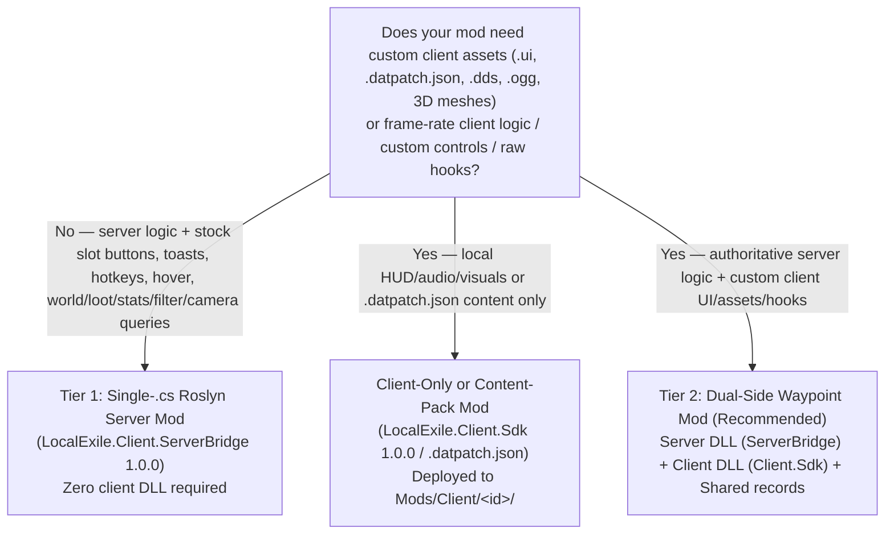

# Getting Started with NativeMods

Build, test, and package **Path of Exile 3.29** mods for [LocalExile](https://github.com/LocalExile/LocalExile) using **NativeMods** (`SdkVersion 1.0.0`, C ABI `0.4.0`).

[← Documentation Home](../README.md) · [Capabilities & Limits](capabilities-and-limits.md) · [Autogenerated API Reference](../api/README.md)

---

## Quickstart with `nativemods` CLI & Local NuGet (`1.0.0`)

Scaffold, validate, and merge multi-mod content packs directly from the `nativemods` CLI (`src/LocalExile.Client.Cli/`):

```bash
# 1. Pack versioned 1.0.0 local NuGet packages (LocalExile.Client.Sdk & LocalExile.Client.ServerBridge + .snupkg)
./scripts/pack-sdk-nuget.sh -o dist/nuget

# 2. Scaffold a new mod (tier1 | dual | content)
dotnet run --project src/LocalExile.Client.Cli -- new tier1 my-qol-mod --out ./my-qol-mod
dotnet run --project src/LocalExile.Client.Cli -- new dual my-feature --out ./my-feature
dotnet run --project src/LocalExile.Client.Cli -- new content my-relics --out ./my-relics

# 3. Validate manifest, .ui layouts, encodings, .datpatch.json & cross-mod conflicts
dotnet run --project src/LocalExile.Client.Cli -- validate ./my-relics --against ./other-mod

# 4. Build deterministic .merged-cache/ + content-row-map.json against stock 3.29 Bundles2
dotnet run --project src/LocalExile.Client.Cli -- merge \
  --stock /path/to/LocalExile/Client \
  --out ./Mods/Client/.merged-cache \
  ./my-relics ./other-mod
```

> **NuGet Consumption:** External mod repos can point a `nuget.config` source at `dist/nuget` and reference `<PackageReference Include="LocalExile.Client.Sdk" Version="1.0.0" />` (client half) or `<PackageReference Include="LocalExile.Client.ServerBridge" Version="1.0.0" />` (server half) instead of `<ProjectReference>`.

---

## Choose Your Mod Tier (Decision Tree)

NativeMods supports three clean authoring patterns. Pick the lightest tier that satisfies your feature:



| Dimension | Tier 1: Server-Only (`ServerBridge 1.0.0`) | Client-Only (`Client.Sdk 1.0.0`) | Tier 2: Dual-Side Waypoint Mod |
|---|---|---|---|
| **Client DLL required?** | No (optional data-only `client/` `.ui` overlay) | Yes (`<id>.Client.dll`; optional for data-only `.datpatch.json`) | Yes (`<id>.Client.dll` + `<id>.dll`) |
| **Server DLL / `.cs` required?** | Yes (`Mods/Binaries/<id>/`) | No | Yes (`Mods/Binaries/<id>/`) |
| **Stock slots, toasts, hotkeys, screen/hover events** | Yes (`session.Phase1`) | Yes (`context.Game.*`) | Yes (both sides) |
| **World entities, visible loot, stats, area, filter, camera** | Yes (`session.Phase2`) | Yes (`context.Game.*`) | Yes (both sides) |
| **Custom `.ui` panels & server-driven controls** | Yes (`session.Ui` + data-only overlay) | Yes (`context.Game.Ui`) | Yes (`context.Game.Ui` or `session.Ui`) |
| **Per-frame client logic / custom controls / `.datpatch.json` / 3D / audio** | Audio & effects via `session.Ui`; no client code | Full access | Full access |
| **Vanilla unmodded client fallback** | Built-in (`session.HasNativeHost` check) | N/A | Built-in (`supportsGracefulFallback: true`) |
| **CLI scaffold command** | `nativemods new tier1 <id>` | `nativemods new content <id>` | `nativemods new dual <id>` |
| **Reference examples** | `LocalExileGatewayHost` + `session.Phase1`/`Phase2` | `DualMod.ContentPackDemo` / minimal `IClientMod` below | `DualMod.LootTools`, `DualMod.StashQol`, `DualMod.SkipCampaign`, `DualMod.MaxwellPet`, `DualMod.SiphonOrb`, `DualMod.HarvestGarden` |

---

## Prerequisites & Build Gate

- **Target game builds:** Path of Exile **3.29.3c** and **3.29.3d** only (Win64 / Proton).
- **.NET SDK:** `.NET 10 SDK` (`net10.0`, `<Nullable>enable</Nullable>`, `<ImplicitUsings>enable</ImplicitUsings>`, `<TreatWarningsAsErrors>true</TreatWarningsAsErrors>`).
- **Library references (project reference or `dist/nuget` `1.0.0` packages):**
  - Client mods compile against **`LocalExile.Client.Sdk`** (`1.0.0`) **only** — never reference `LocalExile.Client.Host`.
  - Server mods reference **`LocalExile.Client.ServerBridge`** (`1.0.0`).
  - Content/asset generators & `.datpatch.json` mergers use **`LocalExile.Client.AssetPipeline`**.
  - Packaging, `.ui` linting, `.datpatch.json` validation, and `.merged-cache/` building use **`LocalExile.Client.Waypoint`**.
- **Solution build & test gate:**
  ```bash
  dotnet build NativeMods.slnx -c Release
  dotnet test NativeMods.slnx -c Release --no-build
  ```

---

## Reference Showcases in This Repository (`1.0.0`)

Study these verified, tested examples before writing a new mod from scratch:

| Example | Path | Demonstrates |
|---|---|---|
| **Content Pack Demo** *(Phase 3 `1.0.0`)* | `examples/DualMod.ContentPackDemo/` | Two independent `.datpatch.json` mods (`ModAlpha.AetherRelics` + `ModBeta.StackMastery`) sharing `BaseItemTypes`, `ItemVisualIdentity`, `CurrencyItems`, `Mods`, and dead `Stats` slots cleanly into `.merged-cache/` + `content-row-map.json` (incl. `StackSize = 65535` & Route A `StatDescriptions`) |
| **Orb of Siphoning** *(Updated `1.0.0`)* | `examples/DualMod.SiphonOrb/` | Brand-new dual-stage Custom Currency with declarative `client/patches/siphon-orb.datpatch.json`, configurable `settings.json` natural world drops via LocalExile Part 2b `ItemCatalog.RegisterOverlay` + `DropDataProvider.Default.RegisterOverlay` (zero SQLite mutation, zero reflection), `78×78` flood-fill RGBA8 icons, `SiphonPicker.ui`, and atomic Gateway affix transactions |
| **Loot Tools** *(Phase 2 `0.4.0`)* | `examples/DualMod.LootTools/` | Filter-Aware Loot Magnet (`Alt+M`), AoE Pickup (`Alt+G`), Atomic Ground Loot Merger (`Alt+R` + `AreaTick`), Filter Reload (`Alt+F`), `LootToolsPanel.ui`, collectible-ALC-safe Camera Zoom Override (`IWorldService`, `IItemFilterService`, `IGameLifecycle`, `ICameraService`) with **zero LocalExile edits** |
| **Stash QoL** *(Phase 1 `0.3.0`)* | `examples/DualMod.StashQol/` | 8 in-game QoL tools: Deposit All, Vendor All, Sort, Map/Blight Upgrades, Regex Roller, `Ctrl+Shift+RMB` Bulk Stack Use, PoB Passive Import + HUD Toasts (`IScreensService`, `IInputService`/`IKeybindRegistry`, `IHoverService`, `IToastService`) |
| **Skip Campaign** *(Phase 1 `0.3.0`)* | `examples/DualMod.SkipCampaign/` | Pre-game `Skip Campaign` toggle on `ScreenSlot.LeagueCardModes` & `ScreenSlot.CreateCharacterBar`, `IPreGameService` `CreateCharacter.S78` option injection, `GameEvents.CharacterCreated` |
| **Maxwell the Cat Pet** | `examples/DualMod.MaxwellPet/` | Brand-new Pet MTX (`MtxTypes`/`MtxTypeGameSpecific`/`Pet` `.datc64` appends, Cosmetics `K` menu via `LocalExilePetMtxRegistrar` + `OnCosmeticChanged`, `.glb`/`.dds`/`.ast` 3D pipeline, `MaxwellPanel.ui`, looping FMOD 2.03 `.ogg` audio) |
| **Harvest Garden** | `examples/DualMod.HarvestGarden/` | Custom UI control (`GrowthGauge`), GEAL built-in (`GardenRipen`), custom ruleset (`0xA1`), custom opcode, async `On<T>` handlers, and graceful vanilla chat fallback |

---

## Skeleton 1: Server-Only Mod (Tier 1 + Optional Server-Driven Native UI)

A standard LocalExile server mod requires **no `nativeClient` block** in `mod.json` if it only uses server-side `GameEvents` and Tier 1 `ServerBridge` APIs (`session.Phase1` / `session.Phase2`). To open native `.ui` windows on NativeMods-equipped clients without shipping a client C# DLL, add a data-only `nativeClient` block containing your `.ui` overlay and drive it via `session.Ui` (`IClientUiSession`).

```text
my-server-mod/
├─ mod.json
├─ settings.json                  # Optional; preserved across Waypoint upgrades
├─ MyServerMod.csproj             # Produces my-server-mod.dll
├─ MyServerMod.cs                 # Authoritative logic + LocalExileGatewayHost / ClientBridgeHost
└─ client/                        # Optional: data-only .ui overlays (no client DLL)
   └─ Metadata/UI/Mods/MyServerMod/Panel.ui
```

**`mod.json` (pure server-only — backward-compatible with stock Waypoint):**
```json
{
  "id": "my-server-mod",
  "name": "My Server Mod",
  "description": "Adds a custom slash command and optional native panel.",
  "author": "YourName",
  "version": "1.0.0",
  "compatibleClientVersions": ["0.5.2-beta"],
  "kind": "feature",
  "depends": ["Game"],
  "assembly": "my-server-mod.dll",
  "enabled": true
}
```

**`MyServerMod.csproj`:**
```xml
<Project Sdk="Microsoft.NET.Sdk">
  <PropertyGroup>
    <TargetFramework>net10.0</TargetFramework>
    <Nullable>enable</Nullable>
    <ImplicitUsings>enable</ImplicitUsings>
    <AssemblyName>my-server-mod</AssemblyName>
  </PropertyGroup>
  <ItemGroup>
    <ProjectReference Include="..\..\src\LocalExile.Client.ServerBridge\LocalExile.Client.ServerBridge.csproj" />
  </ItemGroup>
</Project>
```

---

## Skeleton 2: Client-Only Mod

Use a client-only mod for local HUD overlays, visual tweaks, custom audio feedback, or client-side `.ui` tools that need no server half. Deployed into `<LocalExileRoot>/Mods/Client/<id>/`.

```text
my-hud/
├─ mod.json
├─ MyHud.Client.csproj            # Produces my-hud.Client.dll
├─ MyHudClientMod.cs              # Implements IClientMod
└─ client/
   └─ Metadata/UI/Mods/Hud/Overlay.ui
```

> **Namespace Tip:** `DualModPackageValidator.IsModNamespacedPath` allows `Mods/<id>/` **or** `Mods/<last-hyphen-segment>/`. For `id = "my-hud"`, both `Mods/my-hud/` and `Mods/Hud/` pass validation with zero warnings. See [Capabilities & Limits — Namespace Rules](capabilities-and-limits.md#4-namespace-rules-vs-replaces) for the hyphenated-ID pitfall (`PAY003`).

**`mod.json` (client-only):**
```json
{
  "id": "my-hud",
  "name": "My HUD Overlay",
  "description": "Displays a local client-only status panel.",
  "author": "YourName",
  "version": "1.0.0",
  "compatibleClientVersions": ["0.5.2-beta"],
  "kind": "feature",
  "depends": [],
  "assembly": "my-hud.dll",
  "enabled": true,
  "nativeClient": {
    "required": false,
    "sdkVersionRange": ">=0.4.0 <2.0.0",
    "supportedBuilds": ["3.29.3d", "3.29.3c"],
    "assembly": "my-hud.Client.dll",
    "payloadDir": "client",
    "overlays": [
      "Metadata/UI/Mods/Hud/Overlay.ui"
    ],
    "replaces": [],
    "rawAccess": false
  }
}
```

**`MyHud.Client.csproj` (references ONLY `LocalExile.Client.Sdk`):**
```xml
<Project Sdk="Microsoft.NET.Sdk">
  <PropertyGroup>
    <TargetFramework>net10.0</TargetFramework>
    <Nullable>enable</Nullable>
    <ImplicitUsings>enable</ImplicitUsings>
    <AssemblyName>my-hud.Client</AssemblyName>
  </PropertyGroup>
  <ItemGroup>
    <ProjectReference Include="..\..\src\LocalExile.Client.Sdk\LocalExile.Client.Sdk.csproj" />
  </ItemGroup>
</Project>
```

**`MyHudClientMod.cs` (`IClientMod` with proper lifecycle & unload guards):**
```csharp
using LocalExile.Client.Sdk;
using LocalExile.Client.Sdk.Engine;

namespace MyHud.Client;

public sealed class MyHudClientMod : IClientMod
{
    private IClientContext? _context;
    private IUiWindow? _window;
    private bool _unloading;

    public void Load(IClientContext context)
    {
        _context = context;
        _window = context.Game.Ui.Load("Metadata/UI/Mods/Hud/Overlay.ui", "my_hud_window");
        _window.Closed += OnWindowClosed;
        context.TrackDisposable(_window);
        context.Game.Frame += OnFrame;
        context.Logger.Info("MyHudClientMod loaded.");
    }

    public void Unload()
    {
        _unloading = true;
        if (_context is not null)
        {
            _context.Game.Frame -= OnFrame;
        }
        if (_window is { } window)
        {
            window.Closed -= OnWindowClosed;
            window.Close();
        }
        _window = null;
        _context = null;
    }

    private void OnWindowClosed()
    {
        if (_window is { } closed)
            closed.Closed -= OnWindowClosed;
        _window = null;
    }

    private void OnFrame(float deltaSeconds)
    {
        if (_unloading || _window is not { IsOpen: true })
            return;
        // Runs on the game thread; never assert a single fixed OS TID.
    }
}
```

---

## Skeleton 3: Dual-Side Waypoint Mod (Tier 2 — Recommended)

This is the canonical layout used by `examples/DualMod.LootTools/`, `examples/DualMod.StashQol/`, `examples/DualMod.SkipCampaign/`, `examples/DualMod.HarvestGarden/`, `examples/DualMod.MaxwellPet/`, and `examples/DualMod.SiphonOrb/`.

```text
DualMod.MyFeature/
├─ mod.json                       # Unified LocalExile + nativeClient Waypoint manifest
├─ settings.json                  # User config template (preserved on Waypoint upgrade)
├─ Shared/
│  ├─ DualMod.MyFeature.Shared.csproj
│  └─ MyFeatureMessages.cs        # Protocol constants + typed records
├─ Server/
│  ├─ DualMod.MyFeature.Server.csproj    # Produces my-feature.dll (ServerBridge)
│  ├─ MyFeatureServerMod.cs              # Authoritative server logic + vanilla fallback
│  └─ MyFeatureLocalExileEntry.cs        # Optional Gateway ModHost Roslyn IMod entry point
├─ Client/
│  ├─ DualMod.MyFeature.Client.csproj    # Produces my-feature.Client.dll (Client.Sdk ONLY)
│  └─ MyFeatureClientMod.cs              # Implements IClientMod
└─ client/
   ├─ Metadata/UI/Mods/Feature/Panel.ui
   └─ Metadata/MiscellaneousObjects/Mods/Feature/Thing.ot
```

### Rule A: Self-Contained Client DLL for Collectible ALC Hot Reload

Compile `Shared/*.cs` directly into `<id>.Client.dll` instead of referencing a separate `Shared.dll`, so `ClientModLoader` can shadow-copy and cleanly unload your entire client mod as a single assembly inside one collectible `AssemblyLoadContext`:

```xml
<Project Sdk="Microsoft.NET.Sdk">
  <PropertyGroup>
    <TargetFramework>net10.0</TargetFramework>
    <Nullable>enable</Nullable>
    <ImplicitUsings>enable</ImplicitUsings>
    <RootNamespace>DualMod.MyFeature.Client</RootNamespace>
    <AssemblyName>my-feature.Client</AssemblyName>
  </PropertyGroup>
  <ItemGroup>
    <Compile Include="..\Shared\*.cs" Link="Shared\%(Filename)%(Extension)" />
  </ItemGroup>
  <ItemGroup>
    <ProjectReference Include="..\..\..\src\LocalExile.Client.Sdk\LocalExile.Client.Sdk.csproj" />
  </ItemGroup>
</Project>
```

### Rule B: LocalExile Gateway Roslyn Entry Point (`Server/*.csproj`)

LocalExile's `ModHost` compiles `.cs` files placed in `Mods/Binaries/<id>/` against the live Gateway assemblies (`GameServer.Modding`, `GameServer.Core`, `GameServer.Gateway`, `game.dll`) while also loading sibling DLLs. Keep your testable server logic in `MyFeatureServerMod.cs` and ship `MyFeatureLocalExileEntry.cs` using **`LocalExileGatewayHost.Create(...)`** as content copied to output.

> **Qualification Gotcha:** Always qualify **`global::Client.For(player)`** when referencing LocalExile's core `Client` class in files that import `LocalExile.Client.ServerBridge` (which defines `LocalExile.Client.ServerBridge.Client`).

```xml
<Project Sdk="Microsoft.NET.Sdk">
  <PropertyGroup>
    <TargetFramework>net10.0</TargetFramework>
    <Nullable>enable</Nullable>
    <ImplicitUsings>enable</ImplicitUsings>
    <RootNamespace>DualMod.MyFeature.Server</RootNamespace>
    <AssemblyName>my-feature</AssemblyName>
  </PropertyGroup>
  <ItemGroup>
    <Compile Remove="MyFeatureLocalExileEntry.cs" />
    <None Include="MyFeatureLocalExileEntry.cs" CopyToOutputDirectory="PreserveNewest" />
  </ItemGroup>
  <ItemGroup>
    <ProjectReference Include="..\Shared\DualMod.MyFeature.Shared.csproj" />
    <ProjectReference Include="..\..\..\src\LocalExile.Client.ServerBridge\LocalExile.Client.ServerBridge.csproj" />
  </ItemGroup>
</Project>
```

### Complete Dual-Side `mod.json` Template

```json
{
  "id": "my-feature",
  "name": "My Feature",
  "description": "Short one-sentence description of what this mod adds.",
  "author": "YourName",
  "version": "1.0.0",
  "compatibleClientVersions": ["0.5.2-beta"],
  "kind": "feature",
  "depends": ["Game"],
  "assembly": "my-feature.dll",
  "enabled": true,
  "nativeClient": {
    "required": false,
    "sdkVersionRange": ">=1.0.0 <2.0.0",
    "supportedBuilds": ["3.29.3d", "3.29.3c"],
    "assembly": "my-feature.Client.dll",
    "payloadDir": "client",
    "overlays": [
      "Metadata/UI/Mods/Feature/Panel.ui",
      "Metadata/MiscellaneousObjects/Mods/Feature/Thing.ot"
    ],
    "datPatches": [
      "patches/my-feature.datpatch.json"
    ],
    "replaces": [],
    "rawAccess": false,
    "customOpcodes": [
      { "id": 1201, "name": "MyFeatureAction", "direction": "ClientToServer" },
      { "id": 1202, "name": "MyFeatureSync", "direction": "ServerToClient" }
    ],
    "gealBuiltins": ["MyFeaturePulse"],
    "customControls": [],
    "contentRegistries": [
      { "table": "MiscObjects", "entryId": "Metadata/MiscellaneousObjects/Mods/Feature/Thing", "mode": "append" }
    ],
    "serverHalf": {
      "id": "my-feature",
      "minVersion": "1.0.0",
      "supportsGracefulFallback": true,
      "channelName": "my-feature"
    }
  }
}
```

### Host Manifest Enforcement (`ClientModManifest` & `ClientModLoader`)

- **`enabled`:** Both root `enabled` and `nativeClient.enabled` (default `true`) are checked; disabled mods are skipped cleanly.
- **`depends`:** `ClientModLoader` enforces topological load ordering via Kahn's algorithm with cycle detection. `"Game"` is auto-stripped from root `depends` when `nativeClient` is present unless `nativeClient.depends` explicitly overrides it.
- **Integrity digests:** `payloadHash` / `assemblySha256` (client DLL) and `bundleSha256` / `integrity.packageSha256` (packed `.bundle.bin`) are verified independently via SHA-256 before loading `nativeClient.assembly`.

---

## Next Steps

- **Before writing code:** Read [Capabilities, Limits & Hard Engine Ceilings](capabilities-and-limits.md) so you never hit a closed table, parser crash, or ALC leak.
- **Building UI or stock-screen buttons:** [UI, Controls, Stock Screens & Toasts](ui-and-screens.md)
- **Intercepting input, hover, or character creation:** [Input, Keybinds, Hover & Pre-Game](input-hover-pregame.md)
- **Working with world loot, filters, stats, or camera:** [World, Item Filter, Stats & Camera](world-filter-stats-camera.md)
- **Exact type & method signatures:** [Client SDK Core API Reference](../api/sdk-core.md) · [ServerBridge API Reference](../api/server-bridge.md)
